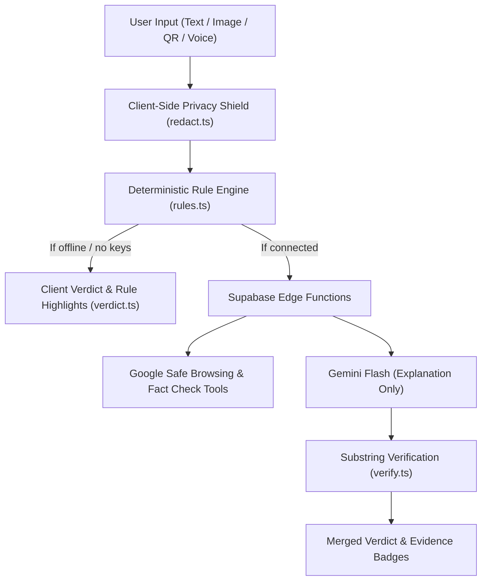

# Pehchaan (पहचान)
### *Recognise the tactics behind scams, forwards, and oversharing — before you give anything away.*

[](https://github.com/isharmamudit/pehchaan)
[](https://www.typescriptlang.org/)
[](https://react.dev/)
[](https://tailwindcss.com/)
[](https://vitejs.dev/)
[](#privacy-and-offline-architecture)
[](#bilingual-experience)
[](#)

---

**Pehchaan** is an offline-first, mobile-optimised web application created to protect citizens across India against modern social engineering threats: **Digital Arrest calls**, **Bank KYC phishing**, **Fake UPI "receive money" QR codes**, **Viral WhatsApp hoaxes**, and **social media oversharing**.

Instead of blacklisting individual phone numbers or static URLs (which change every minute), **Pehchaan teaches and detects the 9 universal psychological pressure tactics** used by attackers.

---

## 📱 Live Experience & Mobile-First Phone UI

Pehchaan is engineered from the ground up for handheld mobile devices:
- **Bottom Navigation Bar**: Persistent iOS/Android style tab bar (`Check`, `Practise`, `Protect`, `Demo`, `Home`) with safe-area insets (`env(safe-area-inset-bottom)`).
- **Notch & Dynamic Island Safe**: Dynamic top app bar clearance (`env(safe-area-inset-top)`) with frosted glass backdrop blur.
- **Touch-Friendly Controls**: Thumb-reach action buttons, 1-tap clipboard paste, and swipeable filters.
- **Zero Horizontal Wobble**: Hard-bounded viewports with responsive auto-wrapping (`[overflow-wrap:anywhere]`) preventing accidental horizontal scrolling.

---

## ⚡ The Nine Pressure Tactics

Every scam, phishing link, or coercive call relies on one or more of these nine psychological pressure points:

| # | Tactic | Description | Example Pattern |
|---|---|---|---|
| **01** | **Urgency Trap** *(जल्दीबाजी)* | Imposes an artificial countdown to panic the victim | *"Within 24 hours"*, *"Immediate update required"* |
| **02** | **Threat of Loss / Fear** *(डर और धमकी)* | Threatens arrest, service disconnection, or police action | *"Non-bailable warrant issued"*, *"Electricity cut"* |
| **03** | **False Authority** *(फर्जी पहचान)* | Impersonates CBI, Cyber Police, RBI, or Bank Officials | *"Inspector Sharma from CBI Cyber Cell"* |
| **04** | **Unearned Reward / Greed** *(लालच)* | Promises lottery prizes, work-from-home tasks, crypto payouts | *"Earn ₹5,000/day by liking YouTube videos"* |
| **05** | **Isolation Command** *(अकेला करना)* | Demands silence and isolation from family or advisors | *"Do not disconnect the call, stay in the room"* |
| **06** | **Credential Fishing** *(गुप्त जानकारी मांगना)* | Demands OTP, PIN, password, or Aadhaar confirmation | *"Share the 6-digit OTP received on your mobile"* |
| **07** | **Remote Access Trap** *(ऐप डाउनलोड करवाना)* | Instructs victim to install screen-sharing software | *"Download AnyDesk / TeamViewer for verification"* |
| **08** | **Reverse Payment Trap** *(पैसे भेजने का झांसा)* | Deceives victim into paying via QR code or payment link | *"Scan this QR code to receive your cash prize"* |
| **09** | **Viral Cascade Pressure** *(अंधाधुंध शेयरिंग)* | Coerces immediate forwarding to WhatsApp groups | *"Forward to 10 groups before midnight or else..."* |

---

## 🛠️ Core Capabilities & Screens

```
                                      ┌──────────────┐
                                      │   PEHCHAAN   │
                                      └──────┬───────┘
                                             │
      ┌──────────────────┬───────────────────┼───────────────────┬──────────────────┐
      ▼                  ▼                   ▼                   ▼                  ▼
┌───────────┐      ┌───────────┐       ┌───────────┐       ┌───────────┐      ┌───────────┐
│   CHECK   │      │  PRACTISE │       │  PROTECT  │       │   HELP    │      │   DEMO    │
│  Scanner  │      │ Sparring  │       │Post X-Ray │       │   1930    │      │  Guided   │
└───────────┘      └───────────┘       └───────────┘       └───────────┘      └───────────┘
```

### 1. 🛡️ Check (`/check`) — Multi-Modal Tactic Verification
- **Paste & Analyse**: Paste suspicious SMS, WhatsApp forwards, or phishing links.
- **1-Tap Clipboard**: Quickly paste copied messages directly into the scanner.
- **Camera & Screenshot OCR**: Upload screenshots of text messages or fraud letters.
- **UPI QR Fraud Scanner**: Reads QR codes and immediately warns if an incoming code is secretly a debit transaction (`upi://pay`).
- **Voice Call Dictation**: Speak Hindi or English call recordings using the browser Web Speech API.
- **Evidence Badges**: Every finding is stamped with an origin badge (`Rule`, `Service`, `Source`, `AI`).
- **Forensic Timeline**: Simulates *"What happens if you reply"* to preview the attacker's trajectory.

### 2. 🥊 Practise & Adaptive Sparring (`/practise`)
- **Realistic Scam Personas**: Practice conversation defence against simulated attackers:
  - *Bank KYC Executive* (Urgency & Credential harvesting)
  - *CBI / Digital Arrest Officer* (Fear, False Authority & Isolation)
  - *Telegram Job Recruiter* (Greed & Deposit traps)
  - *Electricity Bill Disconnection* (Urgency & Threat)
- **Adaptive Sparring**: Maps user decisions across 5 emotional levers (*Fear, Authority, Greed, Urgency, Trust*). If you fold under authority, the next round dynamically challenges your specific vulnerability.
- **Spot-the-Scam Quizzes**: Test your instincts with Before/After quiz sets and exportable scorecards.

### 3. 🔒 Protect (`/protect`) — Post X-Ray
- **EXIF Metadata Auditor**: Extracts hidden GPS coordinates, camera models, and timestamps from family photos on-device.
- **Caption Danger Analysis**: Detects oversharing in social media captions (e.g., announcing empty homes, child's school, flight dates).
- **On-Device Blur Tool**: One-click redact sensitive areas (faces, school badges, number plates) and download a clean copy.
- **Privacy Check-Up**: 12-question security hygiene audit with a k-anonymity breached password check (Pwned Passwords API with SHA-1 prefix hashing).

### 4. 🆘 Emergency Help 1930 (`/help`)
- **Golden-Hour Helpline Card**: Instant one-tap dialer for India's **National Cyber Crime Helpline (1930)**.
- **Incident Playbooks**: Step-by-step ordered response guides for:
  - Money deducted from bank / UPI
  - Compromised Aadhaar / PAN details
  - Coercive "Digital Arrest" harassment
  - Blackmail or compromised intimate photos
  - Direct links to **Chakshu** and **cybercrime.gov.in**

### 5. 🎬 4-Act Guided Live Demo (`/demo` & `/demo/run`)
- 3-minute presenter walkthrough running real pipeline verification:
  1. **The Message**: Live KYC SMS flagged with tactical highlights.
  2. **What Left the Device**: Proof of the client-side privacy shield in JSON.
  3. **The Photo**: Post X-Ray extracting location and school leaks.
  4. **The Scammer**: AI scammer custom-generated using the leaked photo details.

---

## 🔒 Privacy Architecture & Principles Enforced in Code

Pehchaan enforces strict privacy guarantees in source code, not marketing copy:

| Principle | Technical Enforcement in Code |
|---|---|
| **Zero-Knowledge Privacy Shield** | `src/core/redact.ts` masks phone numbers, Aadhaar, PAN, emails, bank accounts, Luhn credit cards, and OTPs in the browser **before** any network call. |
| **Deterministic Rules First** | Local heuristic rules run first on raw text; AI only generates explanatory text (`src/core/pipeline.ts`). |
| **No Fabricated Evidence** | `src/core/verify.ts` programmatically rejects any AI quote that is not a verified substring of the input. |
| **Never Say "Safe"** | Verdicts are strictly bounded to `likely_scam`, `suspicious`, or `no_red_flags`. There is no misleading "guaranteed safe" stamp (`src/core/verdict.ts`). |
| **Zero Storage** | No user database, no sign-up accounts, no message storage, and zero content logged. |
| **Local Offline Guarantee** | The core detection pipeline flags 12/12 scam fixtures with zero network connectivity or API keys. |



---

## 🌐 Bilingual Experience (द्विभाषी)

Pehchaan supports seamless switching between **English** and **Hindi (हिंदी)** across every screen, explanation, and helpline step:
- Built with custom typography pairings: **Schibsted Grotesk** and **Noto Sans Devanagari**.
- Tone-sensitive translations adapted to everyday Indian parlance (Hinglish and Hindi).

---

## 🚀 Getting Started

### Prerequisites
- Node.js 18+
- npm or pnpm

### Installation

1. **Clone the repository:**
   ```bash
   git clone https://github.com/isharmamudit/pehchaan.git
   cd pehchaan
   ```

2. **Install dependencies:**
   ```bash
   npm install
   ```

3. **Configure environment (optional for offline testing):**
   ```bash
   cp .env.example .env.local
   ```

4. **Start the development server:**
   ```bash
   npm run dev
   ```
   Open `http://localhost:5173` in your browser.

---

## 📱 Testing on Mobile Phone

Vite is pre-configured with `host: true` and tunnel support:

1. **Local Network (Wi-Fi):**
   - Ensure your phone and PC are on the same Wi-Fi network.
   - Open `http://<your-pc-ip>:5173/` in mobile Safari or Chrome.

2. **Tunneling (e.g. ngrok):**
   ```bash
   ngrok http 5173
   ```
   Vite includes `allowedHosts` support for `.ngrok-free.dev` tunnels in `vite.config.ts`.

---

## 🧪 Testing & Verification

Pehchaan has a comprehensive test suite of **163 unit and integration tests** covering rules, lookalike URLs, redactions, scoring levers, and debrief generators:

```bash
# Run all unit tests
npm test

# Run tests with single-run flag
npm test -- --run

# Run production build check
npm run build
```

---

## 📁 Repository Structure

```
pehchaan/
├── index.html                   # Mobile web app viewport & safe-area meta tags
├── vite.config.ts               # Vite configuration (host: true, allowedHosts)
├── tailwind.config.js           # Design tokens, palette, and typography
├── src/
│   ├── components/              # UI building blocks
│   │   ├── BottomNav.tsx        # Mobile bottom tab bar (Home, Check, Practise, Protect, Demo)
│   │   ├── SiteNav.tsx          # Frosted glass app bar with safe-area insets
│   │   ├── ui.tsx               # Page, Card, PageTitle, EvidenceBadge, VerdictBand
│   │   ├── HeroCheckCard.tsx    # Animated interactive landing showcase
│   │   └── check/               # Highlighted spans, PrivacyChip, ShareCard
│   ├── core/                    # Pure deterministic logic (Zero DOM, Zero Network)
│   │   ├── tactics.ts           # The 9 tactics specification (single source of truth)
│   │   ├── rules.ts             # Regex & heuristic detection in EN, Hinglish, Hindi
│   │   ├── redact.ts            # Privacy shield (Aadhaar, PAN, Cards, Phones, OTPs)
│   │   ├── verdict.ts           # Verdict scoring engine
│   │   ├── verify.ts            # AI substring verification guardrail
│   │   ├── levers.ts            # Psychological pressure levers & profile
│   │   ├── personas.ts          # Sparring persona dialogue fallbacks
│   │   └── sparring.ts          # Interactive conversation scoring engine
│   ├── pages/                   # Application screens
│   │   ├── Landing.tsx          # Educational landing page with animated ribbon
│   │   ├── Check.tsx            # Multi-modal scam scanner
│   │   ├── Practise.tsx         # Persona selector & adaptive weak-spot training
│   │   ├── Spar.tsx             # Conversational sparring chat interface
│   │   ├── Protect.tsx          # Post X-Ray photo metadata & caption privacy
│   │   ├── Help.tsx             # Emergency 1930 helpline & incident playbooks
│   │   └── Demo.tsx             # Preloaded scenarios & 4-act live tour
│   ├── lib/                     # Client-side hardware & utility layer
│   │   ├── qr.ts                # jsQR parser + UPI pay detection
│   │   ├── ocr.ts               # Screenshot OCR extraction
│   │   ├── speech.ts            # Web Speech API dictation
│   │   └── exif.ts              # Client-side EXIF GPS extractor
│   ├── i18n/                    # Localisation dictionary (English & Hindi)
│   └── test/                    # 163 Vitest suites and benchmark fixtures
└── supabase/functions/          # Seven secure Supabase edge functions
    ├── analyze/                 # Gemini Flash contextual explanation
    ├── check-urls/              # Lookalike & Google Safe Browsing verification
    ├── fact-check/              # Google Fact Check Tools integration
    ├── spar/                    # Interactive attacker simulation
    ├── debrief/                 # Post-session coaching analysis
    └── xray/                    # Computer vision privacy auditor
```

---

## 🏆 Built for HackCom 2026

*Theme: Building a Safer Digital World*  
Created to empower digital citizens with the instincts to recognise manipulation and the tools to defend their privacy.
